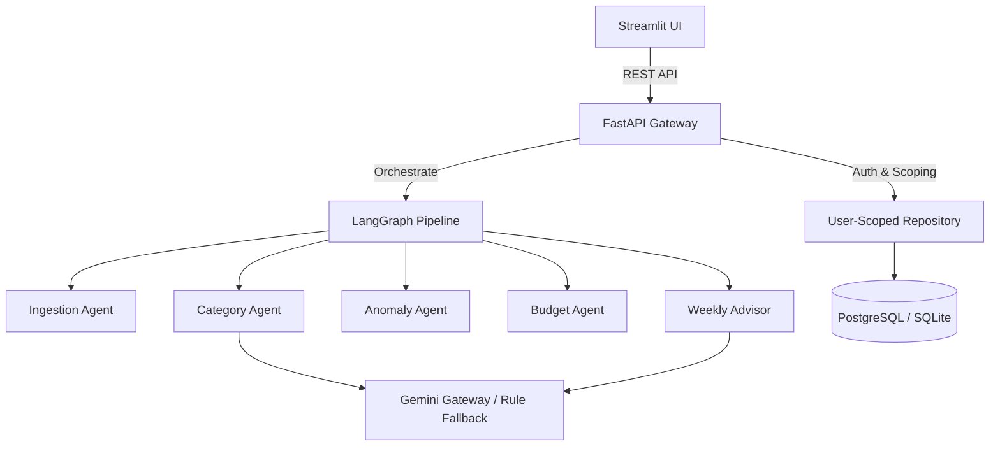

# System Architecture Documentation

## Overview
The **Personal Finance Agent** is built around a decoupled multi-tier architecture:
1. **Frontend**: Streamlit multi-page UI communicating exclusively via REST API.
2. **Backend**: FastAPI 0.110+, SQLAlchemy 2.0, Pydantic v2.
3. **Agent Orchestrator**: LangGraph StateGraph engine coordinating 5 specialized agents.
4. **Database**: PostgreSQL (with Row-Level Security) or SQLite.

